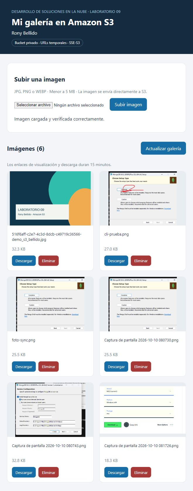
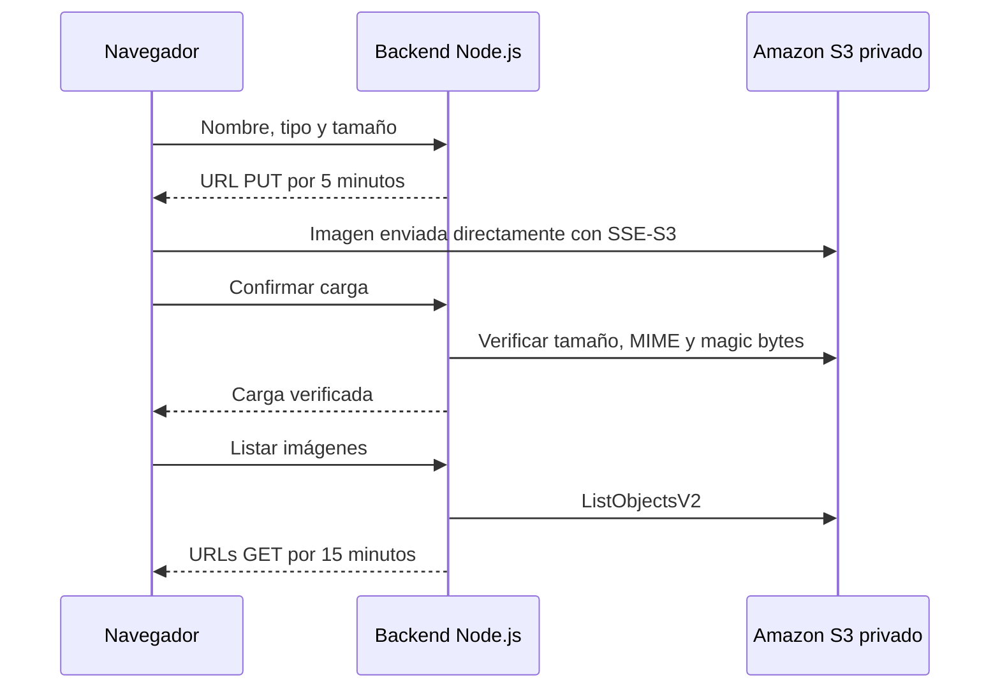

<div align="center">

# Galería de imágenes en Amazon S3

**Laboratorio 09 · Desarrollo de Soluciones en la Nube**  
Rony Bellido


Una aplicación web para **subir, visualizar, descargar y eliminar imágenes** en un bucket privado, mediante URLs prefirmadas y credenciales exclusivas del backend.



*Captura de la primera versión funcional. La interfaz actual incorpora navegación lateral, filtros y vista ampliada.*

</div>

## Funcionalidades

| Función | Comportamiento |
|---|---|
| Carga directa | El navegador envía la imagen a S3 con una URL PUT de 5 minutos. |
| Galería privada | Objetos de originales/ con URLs GET de 15 minutos. |
| Descarga | Enlace temporal con disposición de descarga. |
| Eliminación | El backend elimina el objeto seleccionado; el versionado conserva el historial. |
| Validación | JPG, PNG y WEBP menores a 5 MB, con comprobación antes y después de cargar. |
| Cifrado | Cargas con SSE-S3 AES256. |
| Protección local | Comprobación de origen y prefijo; límite de 20 solicitudes de carga por minuto. |
| Explorar imágenes | Búsqueda por nombre, filtros JPG/PNG/WEBP y orden por fecha, nombre o tamaño. |
| Vista ampliada | Abrir una imagen en un diálogo con metadatos y descarga. |
| Subida visual | Arrastrar un archivo, vista previa y progreso real de transferencia. |
| Diseño adaptable | Navegación lateral en escritorio, galería móvil y controles accesibles. |

## Arquitectura



El archivo viaja del navegador a S3. Las claves AWS se utilizan únicamente en el backend.

## Inicio rápido en Windows

**Requisitos:** Node.js 20 o superior, bucket privado y usuario IAM con permisos sobre ese bucket. Probado con Node.js 22.

1. Descargar o clonar el repositorio.
2. En S3, abrir **Permisos → CORS**, pegar [cors.json](cors.json) y guardar. El origen permitido es `http://localhost:3030`.
3. Hacer doble clic en **[INICIAR.cmd](INICIAR.cmd)**.
4. Seleccionar el **CSV de claves de acceso de IAM**. El iniciador usa las claves en el entorno del proceso y no copia el CSV al proyecto.
5. La galería abre en **http://localhost:3030**. Mantener la terminal abierta.

Con credenciales ya disponibles mediante la cadena de proveedores del SDK, también puede iniciarse desde PowerShell:

```powershell
npm ci
$env:AWS_REGION="us-east-1"
$env:S3_BUCKET="lab-09-bellido-20261014-4826"
$env:PORT="3030"
npm start
```

[.env.example](.env.example) documenta las variables. El servidor no carga archivos `.env` automáticamente. En EC2 se recomienda usar un rol IAM.

## Estructura del proyecto

```text
public/index.html       Interfaz y carga directa a S3
server.js               API, firmas y validación
cors.json               Origen local permitido
INICIAR.cmd             Inicio con doble clic
iniciar.ps1             Selector del CSV de IAM
tests/api.test.js       Pruebas de integración
demo/                   Archivos de demostración
docs/                   Capturas y guion del video
.env.example            Variables de configuración
.gitignore              Exclusión de claves y dependencias
package-lock.json       Instalación reproducible
```

## Endpoints

| Método | Ruta | Resultado |
|---|---|---|
| GET | /api/health | Bucket y región configurados. |
| POST | /api/upload-url | URL PUT temporal y clave única; recibe filename, contentType y sizeBytes. |
| POST | /api/complete-upload | Verifica tamaño, tipo MIME y primeros bytes del objeto; recibe key. |
| GET | /api/images | Lista con URLs de visualización y descarga. |
| DELETE | /api/images/:key | Elimina el objeto de la vista actual del bucket. |

La URL de carga firma el tamaño y `x-amz-server-side-encryption`. El frontend envía el encabezado con valor `AES256`.

## Pruebas y demostración

```powershell
npm test
npm run demo:large
```

Las pruebas automáticas usan un servidor temporal y credenciales ficticias. Comprueban validación, firma, origen y prefijo sin acceder a AWS ni modificar el bucket. El segundo comando genera el archivo local de 10 MB para la prueba manual.

| Prueba manual | Procedimiento | Resultado esperado |
|---|---|---|
| Carga válida | demo/demo_s3_bellido.jpg | Imagen visible después de verificarse. |
| Tipo incorrecto | demo/archivo_no_permitido.pdf | Rechazo de tipo. |
| Tamaño excesivo | demo/imagen_10mb.jpg | Rechazo por superar el límite. |
| Descarga | Botón Descargar | Archivo descargado con URL temporal. |
| Eliminación | Eliminar la imagen de demostración | Desaparece de la galería. |
| Ruta de carga | DevTools → Network | PUT dirigido al endpoint de S3. |
| Expiración | Abrir una URL GET después de 16 minutos | Enlace expirado rechazado. |

Para probar el límite directamente contra el backend, ejecutar en la consola del navegador de la galería:

```javascript
fetch('/api/upload-url', {
  method: 'POST',
  headers: {'Content-Type': 'application/json'},
  body: JSON.stringify({
    filename: 'grande.jpg', contentType: 'image/jpeg', sizeBytes: 10485760
  })
}).then(async r => console.log(r.status, await r.json()));
```

Se espera HTTP **400**. Esta tabla indica pruebas a ejecutar; no sustituye las capturas ni afirma que se comprobó la expiración.

## Seguridad y alcance

- Bucket con **Block Public Access** activado y política que deniega tráfico sin HTTPS.
- Permisos mínimos: `s3:ListBucket` sobre el bucket; `s3:GetObject`, `s3:PutObject` y `s3:DeleteObject` sobre los objetos autorizados.
- No publicar claves, CSV de IAM, archivos `.env` ni `.aws`. El CSV permanece fuera del repositorio.
- Validación posterior de tamaño, MIME y magic bytes. No sustituye un antivirus ni una decodificación completa de la imagen.
- En un bucket versionado, eliminar crea un marcador: las versiones históricas requieren limpieza separada. Esto también aplica a cargas que no superan la validación posterior.
- Servidor ligado a `127.0.0.1`, destinado al laboratorio local. Un despliegue público requiere autenticación y controles adicionales.
- No publicar URLs prefirmadas vigentes: otorgan acceso temporal a quien las posea.

## Video de demostración

**[Ver video explicativo en Google Drive](https://drive.google.com/file/d/1fP4456uqxNu4SPV109Y4ZzJXMAR1XKMY/view)** — 1 minuto 58 segundos, con texto en pantalla, captura real de la galería y resultados comprobados de pruebas de API. Es un montaje explicativo sin narración de audio; no una grabación continua de clics.

El [guion para una grabación en vivo](docs/guion-video.md) propone un recorrido de menos de cinco minutos por la carga, galería, descarga, validaciones, eliminación y seguridad.

## Referencias oficiales

- [Amazon S3 con AWS SDK para JavaScript v3](https://docs.aws.amazon.com/sdk-for-javascript/v3/developer-guide/javascript_s3_code_examples.html)
- [Configuración CORS de Amazon S3](https://docs.aws.amazon.com/AmazonS3/latest/userguide/ManageCorsUsing.html)
- [Guía de Amazon S3](https://docs.aws.amazon.com/AmazonS3/latest/userguide/)
